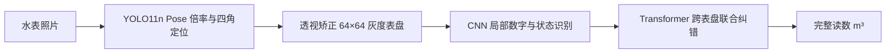

# DripLink · 滴水智联

**Full-pointer water meter reading with YOLO, CNN and Transformer.**

大学生创新创业训练计划的研发项目。当前仅保留 **WMeter5K 全指针表**路线：YOLO11n Pose 定位各倍率表盘及四角，CNN 识别局部图像，Transformer 结合各位信息输出读数。重点是识别准确率、可复现训练和评估。



## 开源发布范围

源码和文档通过 Git 管理，**当前实验的照片、标注、固定划分、模型权重、训练缓存和完整评估结果通过 [v0.1.0 Release](https://github.com/HZX561/DripLink/releases/tag/v0.1.0) 下载**。工作副本继续由 `.gitignore` 排除，避免把大文件反复写入 Git 历史。

| 发布包 | 内容 | 压缩大小 |
|---|---|---:|
| `driplink-models-v0.1.0.zip` | 当前检测器、读数网络、选优配置及来源记录 | 22.24 MiB |
| `driplink-data-v0.1.0.zip` | 3780张全指针原图、完整标注、固定划分及来源清单 | 81.79 MiB |
| `driplink-cache-v0.1.0.zip.001–003` | GT裁剪、训练/验证检测裁剪及训练目标，脚本自动合并 | 188.55 MiB |
| `driplink-reports-v0.1.0.zip` | 验证、历史测试、训练记录与照片核对材料 | 3.74 MiB |

提供 SHA256 清单及自动下载校验脚本。数据来源和适用条件见 [第三方说明](docs/THIRD_PARTY_NOTICES.md)；文件清单与复现步骤见 [复现说明](docs/REPRODUCIBILITY.md)。

```powershell
git clone https://github.com/HZX561/DripLink.git
cd DripLink
.\bootstrap.ps1 -Device cpu -Python 'C:\path\to\python311\python.exe'
.\.venv\Scripts\python.exe scripts/download_assets.py
.\.venv\Scripts\python.exe scripts/verify_project.py --inference --device cpu
.\.venv\Scripts\python.exe -m unittest discover -s tests -v
```

下载脚本默认恢复四个包，约296MiB下载量、448MiB展开空间；已存在且相同的文件会跳过，不同文件默认拒绝覆盖。只看模型结构和运行核心测试时可以省略资产下载；实际识别、训练和完整评估使用配套资产。


GT来自数据集标签，尚未人工复核；示例分类比例不代表整体准确率。

## 当前结果

| 数据划分 | 图片数 | 整数 m³ 完全正确 | 完整读数完全正确 |
|---|---:|---:|---:|
| 训练集 | 2601 | — | — |
| 验证集 | 607 | **93.90%（570/607）** | **79.08%（480/607）** |
| 历史测试集 | 572 | **90.56%（518/572）** | **79.02%（452/572）** |

整数指标比较小数点前全部数字，完整指标比较到 0.0001 m³；无预测的图片计错。真值来自数据集提供的读数，尚未逐张人工复核。测试集曾在之前的实验中查看过，属于内部历史复测，不能称为全新盲测或实体水表独立测试。模型来源、误差和限制见 [实验说明](docs/EXPERIMENT.md)。

## 文件位置

```text
watermeter/               核心模型、图像处理、训练和评估代码
predict_meter.py          单图识别，可输出标注照片
train_meter.py            全指针读数网络微调
train_detector.py         YOLO 检测器微调
evaluate_meter.py         冻结验证集/历史测试集评估
evaluate_external.py      新照片及人工真值的独立评估
prepare_data.py           原图恢复、训练缓存重建
models/                   当前 detector.pt、reader.pt、selection.json
data/images/              当前使用的 3780 张全指针原图
data/manifest.json        冻结的样本、标注和分组划分，禁止直接修改
data/cache/               可重建的训练裁剪缓存；预测缓存不含测试图片
data/raw/                 原始下载包及原项目照片/标注备份
data/provenance/          原始标注及划分来源记录
data/collection/          新照片采集模板
reports/                  验证、历史测试、训练、人工核对和维护记录
scripts/                  完整性检查、模型选优、照片核对导出、日志工具
assets/release.json       Release资源目录、下载地址和SHA256
tests/                    当前流程的回归检查
docs/                     实验、人工任务和文件管理说明
runs/                     今后新训练生成，每次使用新的实验名
```

## 环境

Windows x64、Python 3.11。当前 GPU 环境为 `.venv-wmeter`（PyTorch 2.5.1+cu124），CPU 环境为 `.venv`（2.5.1+cpu）。两份锁文件分别固定 39 项依赖及 wheel 哈希。已有环境可直接使用。

```powershell
# 已有环境：检查依赖；资产齐全时额外检查模型、原图和训练缓存
.\bootstrap.ps1 -Device cuda -SkipInstall

# 新电脑安装：传入本机 Python 3.11 解释器；CPU 版用 -Device cpu
.\bootstrap.ps1 -Device cuda -Python 'C:\path\to\python.exe'

.\.venv-wmeter\Scripts\python.exe scripts/verify_project.py --inference --device cuda:0
.\.venv-wmeter\Scripts\python.exe -m unittest discover -s tests -v
```

固定数据划分、随机种子 42，并保存权重和数据 SHA256、训练参数及训练源码快照。CUDA 自适应池化的反向传播存在非确定性，跨硬件训练不保证逐比特相同；当前选定权重、数据和本次迁移后的预测可核对复现。

## 识别与人工核对

```powershell
.\.venv-wmeter\Scripts\python.exe predict_meter.py '照片路径.jpg' --device cuda:0 --output reports/demo.jpg

# 导出 JPEG 对照图、原图和纯文本核对表，无需 HTML
.\.venv-wmeter\Scripts\python.exe scripts/export_review.py --output reports/review_new --count 16

# 展示预测正确、整数错误和仅小数错误的样本
.\.venv-wmeter\Scripts\python.exe scripts/export_review.py --mode examples --output reports/examples_new --count 6
```

已有的 16 张核对照片、`comparison_16.jpg` 和 `review.txt` 位于 `reports/review/`。预测值与数据集标签都需要结合原图核验，不能当作新采集数据的人工真值。

## 评估与继续训练

所有输出目录和实验名必须是新的，防止覆盖已有结果。

```powershell
# 完整系统验证：只把原始像素传给检测器和读数网络
.\.venv-wmeter\Scripts\python.exe evaluate_meter.py --split val --output reports/val_new --device cuda:0

# 历史测试复测：显式声明已查看过该测试集
.\.venv-wmeter\Scripts\python.exe evaluate_meter.py --split test --acknowledge-retest --output reports/test_retest_new --device cuda:0

# 在冻结训练集上微调读数网络，不修改 models 中的当前模型
.\.venv-wmeter\Scripts\python.exe train_meter.py --name reader_v2 --epochs 25 --device cuda:0
.\.venv-wmeter\Scripts\python.exe evaluate_meter.py --reader runs/reader_v2/best.pt --split val --output reports/reader_v2_val --device cuda:0

# 按验证集整数准确率、再按完整读数准确率选优，生成独立的新选择文件
.\.venv-wmeter\Scripts\python.exe scripts/select_model.py --reports reports/validation/report.json reports/reader_v2_val/report.json --output models/selection_v2.json
.\.venv-wmeter\Scripts\python.exe predict_meter.py '照片路径.jpg' --selection models/selection_v2.json --device cuda:0
```

验证时可加 `--oracle`，额外诊断人工标注区域下的识别效果；它使用了标注定位，不能作为完整系统准确率。候选模型只允许在验证集上比较。

```powershell
# 重建训练缓存：保持原数据划分，YOLO 仅处理训练集和验证集
.\.venv-wmeter\Scripts\python.exe prepare_data.py --rebuild-cache --device cuda:0

# 可选：在当前检测器基础上进行全指针微调
.\.venv-wmeter\Scripts\python.exe train_detector.py --name pointer_detector_v2 --epochs 30 --device 0
```

新检测器用 `evaluate_meter.py --detector 新权重路径 --split val ...` 比较完整系统效果。当前检测器的历史训练包含混合型图片；上述微调命令只使用冻结的全指针训练集。未经验证选优，不替换 `models/` 的当前权重。

独立评估需要新实体水表照片和人工读数，模板目前为空，参见 [人工任务与采集说明](docs/HUMAN_TASKS.md)。清理范围和备份位置见 [文件管理](docs/FILE_MANAGEMENT.md)。

## 许可证与致谢

本项目源码采用 **GNU AGPL-3.0-only**，见 [LICENSE](LICENSE)。项目使用的 Ultralytics 同样提供 AGPL-3.0 版本；第三方组件及数据的权利仍按各自许可处理，见 [第三方来源说明](docs/THIRD_PARTY_NOTICES.md)。

感谢 [Ultralytics](https://github.com/ultralytics/ultralytics) 的检测框架，以及 [WMeter-Reader / WMeter5K](https://github.com/ZZZHANG-jx/WMeter-Reader) 的数据与研究工作。本项目实验流程与原论文官方实现不同，不能将这里的指标视为对原论文的直接复现。

维护者：[HZX561](https://github.com/HZX561)。
